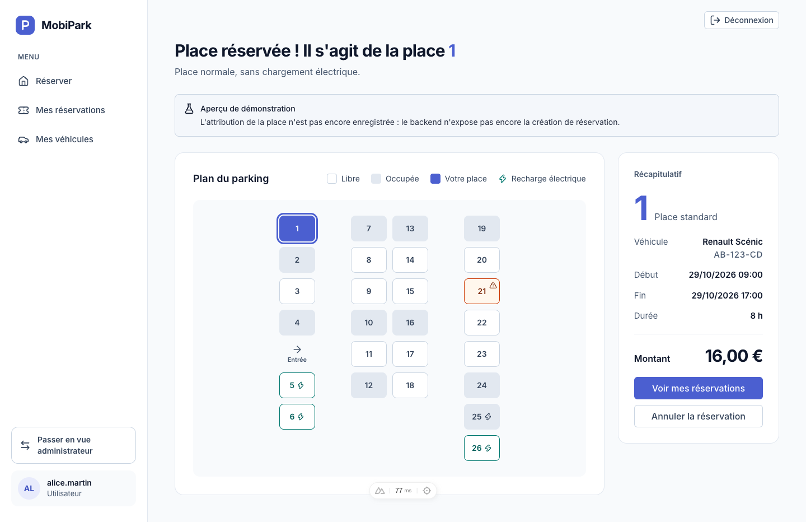
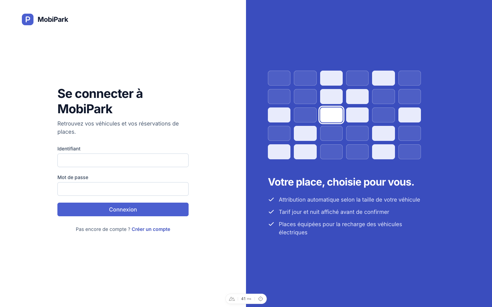
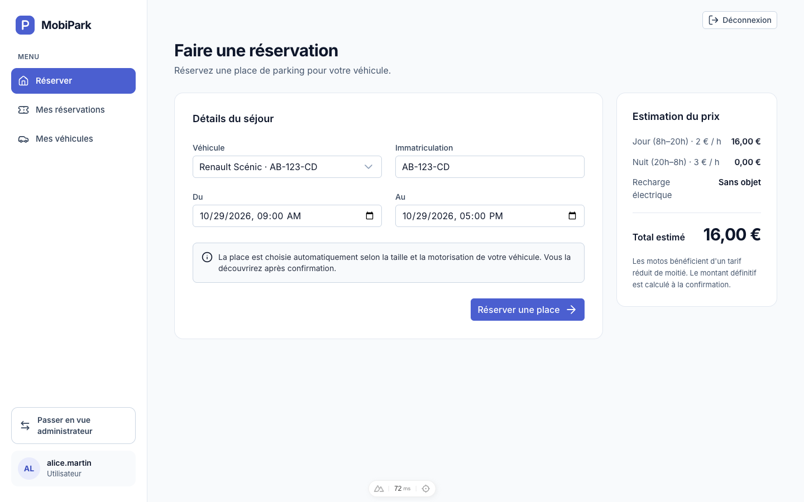
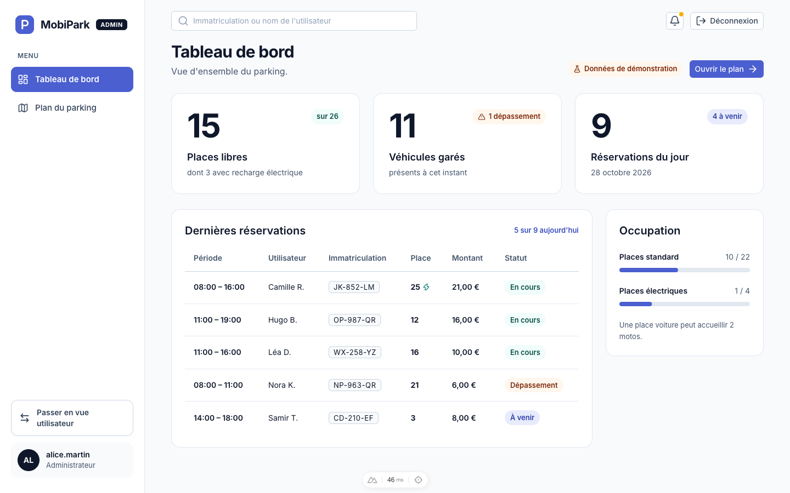
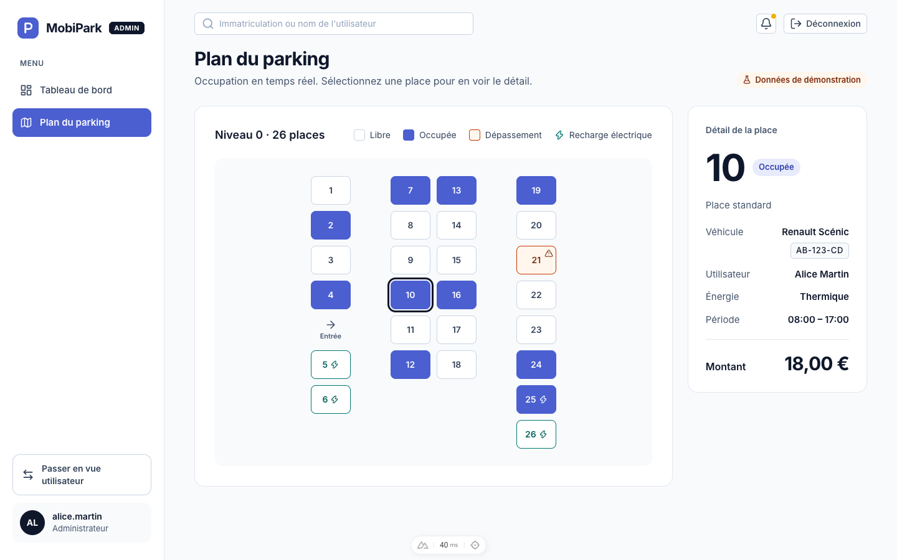
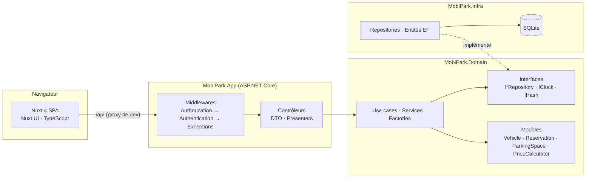
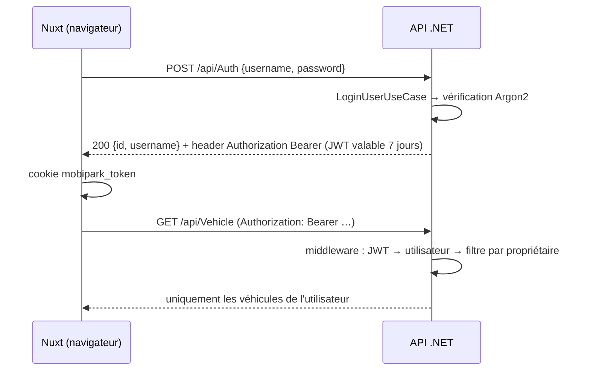
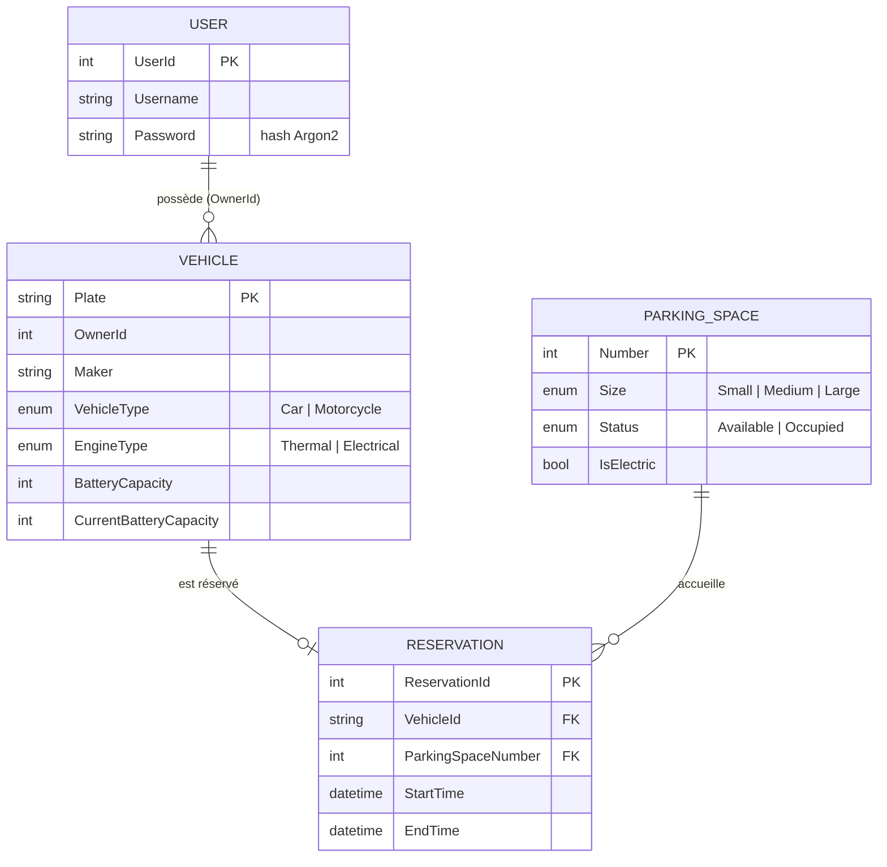

<div align="center">

# 🅿️ MobiPark

**Réservez votre place de parking en quelques clics — la place est choisie pour vous.**




</div>

---

## Sommaire
1. [Le projet](#le-projet)
2. [Aperçu](#aperçu)
3. [Architecture](#architecture)
4. [Démarrer](#démarrer)
5. [API](#api)
6. [Règles métier et tarifs](#règles-métier-et-tarifs)
7. [Qualité : tests, CI, conventions](#qualité--tests-ci-conventions)
8. [État d'avancement](#état-davancement)

## Le projet

MobiPark est une application de gestion et de réservation de places de parking, réalisée dans le cadre du CNAM.

- **L'utilisateur** crée un compte, enregistre ses véhicules (voiture ou moto, thermique ou électrique) et réserve
  une place sur une période donnée. Le prix est estimé avant de confirmer.
- **L'administrateur** suit l'occupation du parking en temps réel : tableau de bord, plan interactif, réservations en dépassement.

Cas d'usage modélisés dans [`misc/usecase.png`](misc/usecase.png) : *ParkingUser* (réserver, modifier, annuler, gérer ses véhicules),
*ParkingOwner* (gérer les places et consulter les réservations) et *ParkingSystem* (système tiers qui met à jour la disponibilité).

## Aperçu

| Connexion | Réserver |
|:--:|:--:|
|  |  |

| Tableau de bord administrateur | Plan interactif |
|:--:|:--:|
|  |  |

## Architecture



### Principes
- **Le domaine ne dépend de rien.** Les règles métier (prix, compatibilité véhicule/place, validation des plaques et des batteries)
  vivent dans `MobiPark.Domain` et se testent sans base de données grâce à des repositories *fake*.
- **Inversion de dépendance.** Le domaine déclare des interfaces ; `MobiPark.Infra` les implémente ; l'injection se fait dans `Program.cs`.
- **Contrôleurs fins.** Ils traduisent HTTP ⇄ domaine ; les erreurs métier sont des exceptions typées converties en JSON
  `{ "error": "..." }` par un middleware (404, 409, 401, 400).
- **Le backend fait foi.** Le frontend s'aligne sur le contrat d'API, jamais l'inverse.

### Authentification



Chaque route filtre par propriétaire : un véhicule porte un `OwnerId`, une réservation appartient au propriétaire de son véhicule.
Accéder à la ressource d'un autre utilisateur renvoie **404** (et non 403), pour ne pas révéler son existence.

### Modèle de données



### Arborescence

```text
MobiPark
├── backend/
│   ├── MobiPark.Domain/        Règles métier (modèles, use cases, services, interfaces)
│   ├── MobiPark.Infra/         EF Core, repositories, hash Argon2, migrations
│   ├── MobiPark.App/           API : contrôleurs, DTO, presenters, middlewares, JWT
│   └── MobiPark.Domain.Test/   Tests xUnit du domaine
├── frontend/
│   └── app/                    Nuxt 4 : pages, layouts, composables, composants, middleware
├── misc/                       Diagrammes UML (PlantUML) et règles de gestion
└── docs/screenshots/           Captures utilisées dans ce README
```

### Stack

| Couche | Technologies |
|---|---|
| Frontend | Nuxt 4, Vue 3, TypeScript strict, Nuxt UI 4, Tailwind CSS 4, pnpm |
| Backend | .NET 8, ASP.NET Core, Entity Framework Core, SQLite, JWT, Argon2 |
| Qualité | xUnit, ESLint, `nuxt typecheck`, GitHub Actions |

## Démarrer

**Prérequis** : [.NET SDK 8](https://dotnet.microsoft.com/download), [Node.js 22+](https://nodejs.org) et [pnpm 9](https://pnpm.io).

```bash
# 1. Backend — http://localhost:5000 (Swagger sur /swagger en développement)
cd backend
dotnet run --project MobiPark.App
```

```bash
# 2. Frontend — http://localhost:3000 (/api est relayé vers le backend)
cd frontend
pnpm install
pnpm dev
```

La base SQLite est créée et migrée automatiquement au démarrage du backend. Ouvrez ensuite <http://localhost:3000>,
cliquez sur **Créer un compte**, ajoutez un véhicule, puis réservez.

## API

JSON en camelCase, énumérations en chaînes. Tout `/api/*` exige un JWT, sauf la connexion et l'inscription.

| Méthode | Route | Description |
|---|---|---|
| `POST` | `/api/Auth` | Connexion — renvoie l'utilisateur et le JWT dans le header `Authorization` |
| `POST` | `/api/Auth/register` | Inscription (même réponse) |
| `GET` | `/api/Auth` | Utilisateur courant |
| `GET` | `/api/Vehicle` | Véhicules de l'utilisateur |
| `GET` | `/api/Vehicle/{plaque}` | Détail d'un véhicule |
| `POST` | `/api/Vehicle` | Ajouter un véhicule (plaque FR/DE, moteur thermique ou électrique) |
| `GET` | `/api/Reservation` | Réservations de l'utilisateur |
| `GET` | `/api/Reservation/{plaque}` | Réservation d'un véhicule |
| `GET` | `/api/Parking/spaces` | Liste des places |
| `PUT` | `/api/Parking/spaces/park?licensePlate=` | Garer un véhicule sur une place compatible |

## Règles métier et tarifs

- **Choix automatique** de la place. Une place voiture accueille 2 motos.
- Un véhicule **ne peut pas** se garer sur une place occupée, trop petite, ou électrique s'il est thermique.
- Une réservation commence **dans le futur** et se termine après son début.
- **Plaques** : format français `AB-123-CD` ou allemand.

| Élément | Tarif |
|---|---|
| Heure de jour (8h – 20h) | 2 € |
| Heure de nuit (20h – 8h) | 3 € |
| Moto | moitié prix |
| Recharge électrique | 0,16 € par unité de batterie à recharger |

Les heures sont arrondies à l'inférieur. Le calcul est dans
[`PriceCalculator`](backend/MobiPark.Domain/Models/PriceCalculator.cs) et reproduit côté frontend pour l'estimation.

## Qualité : tests, CI, conventions

```bash
cd backend  && dotnet test mobipark.sln                      # tests du domaine
cd frontend && pnpm lint && pnpm typecheck && pnpm build     # qualité du frontend
```

- **CI** (GitHub Actions) : build et tests du backend ; lint, typecheck et build du frontend, sur chaque pull request vers `main`.
- **Commits** : [Conventional Commits](https://www.conventionalcommits.org) + [gitmoji](https://gitmoji.dev) en shortcode,
  par exemple `feat: :sparkles: add reservation endpoint` ou `fix: :bug: await SaveChanges`.
- **Branches** : `feature/<n>-<nom>`, pull request vers `main`.
- Les fichiers [`CLAUDE.md`](CLAUDE.md) (racine, `backend/`, `frontend/`) documentent le contexte pour les assistants de code.

## État d'avancement

| | Fonctionnalité | État |
|---|---|---|
| ✅ | Inscription, connexion, JWT, hash Argon2 | Fait |
| ✅ | Véhicules : liste et création, isolés par utilisateur | Fait |
| ✅ | Liste des réservations, estimation du prix | Fait |
| ✅ | Frontend complet (7 écrans de la maquette) | Fait |
| 🧪 | Plan et attribution de la place, espace administrateur | **Données de démonstration** côté frontend |
| ⏳ | `POST /api/Reservation` (choix automatique de la place, prix, une réservation par véhicule à lever) | À faire |
| ⏳ | Rôle administrateur et statistiques du tableau de bord | À faire |
| ⏳ | Modifier / annuler une réservation | À faire |
| ⏳ | Tarif selon l'occupation et la semaine / le week-end, majoration de retard | À faire |
| ⚠️ | Sortir le secret JWT et `mobiPark.db` du dépôt | À faire (sécurité) |

## Licence

[MIT](LICENSE) — © Cnam-MobiPark
